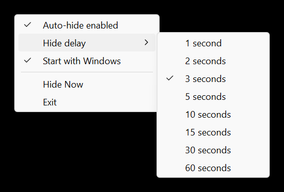

<p align="center">
  
</p>

# Abyss Cursor Hide

[](https://github.com/jacobkozin/AbyssCursorHider/actions/workflows/build.yml)

A small Windows tray utility that hides the mouse pointer when you stop moving
it, and brings it back the instant you do.

It is native Win32 C++ with no installer, no administrator rights, no network
access and nothing extra to install.

<p align="center">
  
</p>

## Features

- Hides the pointer after 1, 2, 3, 5, 10, 15, 30 or 60 seconds without mouse
  input (3 seconds by default).
- Brings it back on any movement, click (left, right, middle, back, forward)
  or turn of the mouse wheel. Typing does not count, so the pointer stays out
  of the way while you type.
- Tray menu: **Auto-hide enabled**, **Hide delay**, **Start with Windows**,
  **Hide Now** and **Exit**.
- Remembers your settings per Windows user. Start with Windows is off until
  you turn it on, and it respects the switch in Task Manager's Startup apps.
- Checks that every restore really worked, and a watchdog brings the pointer
  back if the app is closed unexpectedly. `RestoreCursor.exe` is a one-click
  manual fix.
- Per-monitor DPI aware, so the menu stays sharp on high-DPI and
  mixed-scaling setups.

It hides the standard Windows pointer. Programs that draw their own cursor,
such as some games, drawing apps and web pages with custom cursors, keep
showing theirs.

## Download and run

1. Download the `AbyssCursorHide-<version>-windows-x64.zip` file from the
   [latest release](https://github.com/jacobkozin/AbyssCursorHider/releases/latest)
   and unzip it to a folder only you can change, such as
   `%LOCALAPPDATA%\AbyssCursorHide`.
2. Run `AbyssCursorHide.exe`. Its icon appears in the notification area
   (it may be behind the **^** arrow).
3. Click the icon to open the menu.

Keep `RestoreCursor.exe` in the same folder, and choose **Exit** before moving
or deleting the folder. A Start menu shortcut to `AbyssCursorHide.exe` is
handy: starting the app again is also the quickest fix for a missing pointer
(see below). Requires 64-bit Windows 10 or 11.

While the app runs, Task Manager shows two **Abyss Cursor Hide** processes. The
second one is the watchdog; leave it running.

> **The executables are not code-signed yet.** Windows SmartScreen may say it
> doesn't recognize the app (choose **More info**, then **Run anyway**), and
> some antivirus products flag new unsigned programs. Each release lists
> SHA-256 checksums, and [docs/ANTIVIRUS.md](docs/ANTIVIRUS.md) explains what
> was flagged during testing and how to check a download yourself.

## How it works

Windows has no setting that hides the pointer everywhere, so the app does what
cursor hiders generally do. When the delay runs out, it swaps every standard
system cursor for a transparent one with `SetSystemCursor`. When the mouse is
used again, it reloads your normal cursor scheme with
`SystemParametersInfo(SPI_SETCURSORS)` and reads each cursor back to check that
none is still transparent. Windows loads the scheme inside the program that
asks for it and can quietly skip cursors there, so if one is still
transparent, the app starts a fresh copy of itself
(`AbyssCursorHide.exe --restore`) that reloads the scheme and exits.

It watches the mouse two ways:

- **Raw Input** events bring the pointer back the moment the mouse moves,
  clicks or scrolls.
- A **100 ms poll** of the pointer position and buttons backs it up.

Over the windows of more privileged programs, such as Task Manager or an admin
terminal, Windows hides clicks and the wheel from normal programs, so the app
does not hide the pointer there at all.

It is light. Measured on a Windows 11 PC over 86 hours of normal use (version
5.0.0), it averaged 0.03% of one CPU core, with a single thread and about
13 MB of memory.

## Safety model

Hidden cursors are a system-wide change, so the app is built to always give the
pointer back:

| Situation | What brings the pointer back |
| --- | --- |
| You move, click or scroll | Raw Input, or the 100 ms poll |
| You lock the PC, a UAC prompt appears, or a Remote Desktop session connects or disconnects | Session notifications, and the poll stops hiding while the secure desktop is up |
| You pause auto-hide, change the delay, or the PC wakes from sleep | The app restores right away |
| Windows reloads the scheme but a cursor is still transparent | The app checks every cursor after restoring; if one is still transparent it starts `AbyssCursorHide.exe --restore`, which reloads the scheme in a fresh process, and it doesn't hide again until a restore is confirmed |
| You choose Exit, sign out or shut down | Normal cleanup, and after Exit the watchdog reloads the scheme once more |
| The app crashes | Its unhandled-exception handler, then the watchdog |
| The app's process is killed, for example with `taskkill /F /PID` | The watchdog: a second copy of `AbyssCursorHide.exe`, started with `--watch <pid>`, waits for the app to exit and then reloads the cursor scheme. The app only hides the pointer while the watchdog is running |
| The app and the watchdog are both killed, for example by killing every process with that name | Start the app again, which reloads the scheme before anything else, or see below |

The transparent cursors are never saved to your profile, so signing out or
restarting always brings your normal pointer back.

### No pointer?

Everything below works with the keyboard alone:

1. Start the app again: press the Windows key, type `Abyss`, press Enter. Every
   launch reloads the cursor scheme first, even when the app is already running.
2. Or press Win+R, type the path to `RestoreCursor.exe` (for example
   `%LOCALAPPDATA%\AbyssCursorHide\RestoreCursor.exe`), press Enter, then
   Enter again to close its message.
3. Or press Ctrl+Alt+Del and sign out.

## Build from source

You need Visual Studio 2022 or newer with the **Desktop development with C++**
workload. It includes CMake. From a Developer PowerShell in the repository:

```powershell
cmake --preset windows-x64
cmake --build --preset release
ctest --preset release
cmake --build --preset package   # optional: builds the release ZIP
```

The programs are written to `build/windows-x64/Release/`. GitHub Actions runs
the same presets for Debug and Release on every push to `main` and every pull
request, plus tests that hide and restore the real system cursors thousands of
times on its throwaway machines (they are never built on your PC unless you
configure with `-DABYSS_SYSTEM_CURSOR_TESTS=ON`). CodeQL scans the code too.
Publishing a GitHub Release makes CI build that tag again and attach the ZIP,
its SHA-256 checksum and a build-provenance attestation.

Builds treat warnings as errors, Debug builds also run MSVC code analysis
(`/analyze`), and the programs turn on SDL checks, ASLR, DEP, Control Flow
Guard and CET compatibility and load DLLs from System32 only.

## Project layout

```text
src/main.cpp                  Tray app: window, menu, timer, Raw Input, watchdog and --restore modes
src/cursor_controller.cpp     Hiding, restoring and checking the system cursors
src/windows_settings.cpp      Saved settings and the Start with Windows entry
src/restore_cursor.cpp        RestoreCursor.exe, the manual recovery tool
src/core.cpp                  Small pure functions shared with the unit tests
tests/core_tests.cpp          Unit tests for src/core.cpp
tests/cursor_tests.cpp        Cursor tests that only use private cursors
tests/system_cursor_tests.cpp CI-only tests that hide and restore the real cursors
resources/                    Icon, manifest (per-monitor DPI, no admin) and version info
docs/                         Architecture, testing, releasing, antivirus notes and history
```

## Settings

Settings are stored per user under `HKEY_CURRENT_USER\Software\AbyssCursorHide`
(`Enabled` and `DelaySeconds`). Start with Windows adds an `AbyssCursorHide`
value under `HKEY_CURRENT_USER\Software\Microsoft\Windows\CurrentVersion\Run`;
turning it on or off also removes the app's value under
`...\CurrentVersion\Explorer\StartupApproved\Run`, where Task Manager's Startup
apps page keeps its on/off switch. There are no config files or logs, and the
app never uses the network.

## More documentation

- [Architecture](docs/ARCHITECTURE.md): how the pieces fit together.
- [Testing](docs/TESTING.md): unit tests and the manual checklist, with the
  latest results.
- [Antivirus false positives](docs/ANTIVIRUS.md): what was flagged and why.
- [Releasing](docs/RELEASING.md): how a version is tagged, built and published.
- [History](docs/HISTORY.md): versions 1 through 4.17, and why v5 is a rebuild.

## History in brief

Versions 1 through 4.17 were built in September 2026. The source file for the
final v4.17 binary was lost, so v5 is a clean rebuild of that behavior, with
unit tests, CI and documentation. Only the old binary's checksums are kept, in
`checksums/`; it is not built from this repository.

## License

MIT. See [LICENSE](LICENSE).
