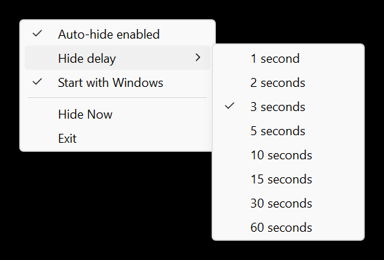

<p align="center">
  
</p>

# Abyss Cursor Hide

[](https://github.com/jacobkozin/AbyssCursorHider/actions/workflows/build.yml)

A small Windows tray utility that hides the mouse pointer when you stop moving
it, and brings it back the instant you do.

It is native Win32 C++ with no installer, no administrator rights, no network
access and nothing extra to install.

<p align="center">
  
</p>

## Features

- Hides the pointer after 1, 2, 3, 5, 10, 15, 30 or 60 seconds without mouse
  input (3 seconds by default).
- Brings it back on any movement, click (left, right, middle, back, forward)
  or scroll. Typing does not count, so the pointer stays out of the way while
  you type.
- Tray menu: **Auto-hide enabled**, **Hide delay**, **Start with Windows**,
  **Hide Now** and **Exit**.
- Remembers your settings per Windows user. Start with Windows is off until
  you turn it on, and it respects the switch in Task Manager's Startup apps.
- A watchdog brings the pointer back if the app is closed unexpectedly, and
  `RestoreCursor.exe` is a one-click manual fix.
- Per-monitor DPI aware, so the menu stays sharp on high-DPI and
  mixed-scaling setups.

## Download and run

1. Download `AbyssCursorHide-5.0.0-windows-x64.zip` from
   [Releases](https://github.com/jacobkozin/AbyssCursorHider/releases) and unzip
   it to a folder you keep, such as `%LOCALAPPDATA%\AbyssCursorHide`.
2. Run `AbyssCursorHide.exe`. Its icon appears in the notification area
   (it may be behind the **^** arrow).
3. Click the icon to open the menu.

Keep `RestoreCursor.exe` in the same folder, and choose **Exit** before moving
or deleting the folder. Requires 64-bit Windows 10 or 11.

> **The executables are not code-signed yet.** Windows SmartScreen may say it
> doesn't recognize the app (choose **More info**, then **Run anyway**), and
> some antivirus products flag new unsigned programs. Each release lists
> SHA-256 checksums, and [docs/ANTIVIRUS.md](docs/ANTIVIRUS.md) explains what
> was flagged during testing and how to check a download yourself.

## How it works

Windows has no setting that hides the pointer everywhere, so the app does what
cursor hiders generally do. When the delay runs out, it swaps every standard
system cursor for a transparent one with `SetSystemCursor`. When the mouse is
used again, it reloads your normal cursor scheme with
`SystemParametersInfo(SPI_SETCURSORS)`.

It watches the mouse two ways:

- **Raw Input** events bring the pointer back the moment the mouse moves,
  clicks or scrolls.
- A **100 ms poll** of the pointer position and buttons keeps working when an
  elevated window such as Task Manager is in front, where background programs
  stop receiving some input events.

It is light. Measured on a Windows 11 PC over 86 hours of normal use, it
averaged 0.03% of one CPU core, with a single thread and about 13 MB of memory.

## Safety model

Hidden cursors are a system-wide change, so the app is built to always give the
pointer back:

| Situation | What brings the pointer back |
| --- | --- |
| You move, click or scroll | Raw Input, or the 100 ms poll |
| You lock the PC, a UAC prompt appears, or a Remote Desktop session connects or disconnects | Session notifications, and the poll stops hiding while the secure desktop is up |
| You pause auto-hide, change the delay, or the PC wakes from sleep | The app restores right away |
| You choose Exit, sign out or shut down | Normal cleanup |
| The app crashes | Its unhandled-exception handler |
| The app's process is killed, for example with `taskkill /F` | The watchdog: a second copy of `AbyssCursorHide.exe`, started with `--watch <pid>`, waits for the app to exit and then reloads the cursor scheme |
| All of the above failed | Run `RestoreCursor.exe`, start the app again, or sign out |

The transparent cursors are never saved to your profile, so signing out or
restarting always brings your normal pointer back.

## Build from source

You need Visual Studio 2022 or newer with the **Desktop development with C++**
workload. It includes CMake. From a Developer PowerShell in the repository:

```powershell
cmake --preset windows-x64
cmake --build --preset release
ctest --preset release
cmake --build --preset package   # optional: builds the release ZIP
```

The programs are written to `build/windows-x64/Release/`. GitHub Actions runs
the same presets for Debug and Release on every push to `main` and every pull
request. Publishing a GitHub Release makes it build that tag again and attach
the ZIP and its SHA-256 checksum to the release.

Builds treat warnings as errors and turn on SDL checks, ASLR, DEP, Control Flow
Guard and CET compatibility.

## Project layout

```text
src/main.cpp               Tray app: window, menu, timer, Raw Input, watchdog
src/cursor_controller.cpp  Hiding and restoring the system cursors
src/windows_settings.cpp   Saved settings and the Start with Windows entry
src/restore_cursor.cpp     RestoreCursor.exe, the manual recovery tool
src/core.cpp               Small pure functions shared with the unit tests
tests/core_tests.cpp       Unit tests, run by ctest
resources/                 Icon, manifest (per-monitor DPI, no admin) and version info
docs/                      Architecture, testing, releasing, antivirus notes and history
```

## Settings

Settings are stored per user under `HKEY_CURRENT_USER\Software\AbyssCursorHide`
(`Enabled` and `DelaySeconds`). Start with Windows adds an `AbyssCursorHide`
value under `HKEY_CURRENT_USER\Software\Microsoft\Windows\CurrentVersion\Run`.
There are no config files or logs, and the app never uses the network.

## More documentation

- [Architecture](docs/ARCHITECTURE.md): how the pieces fit together.
- [Testing](docs/TESTING.md): unit tests and the manual checklist, with the
  latest results.
- [Antivirus false positives](docs/ANTIVIRUS.md): what was flagged and why.
- [Releasing](docs/RELEASING.md): how a version is tagged, built and published.
- [History](docs/HISTORY.md): versions 1 through 4.17, and why v5 is a rebuild.

## History in brief

Versions 1 through 4.17 were built in September 2026. The source file for the
final v4.17 binary was lost, so v5 is a clean rebuild of that behavior, with
unit tests, CI and documentation. Only the old binary's checksums are kept, in
`checksums/`; it is not built from this repository.

## License

MIT. See [LICENSE](LICENSE).
